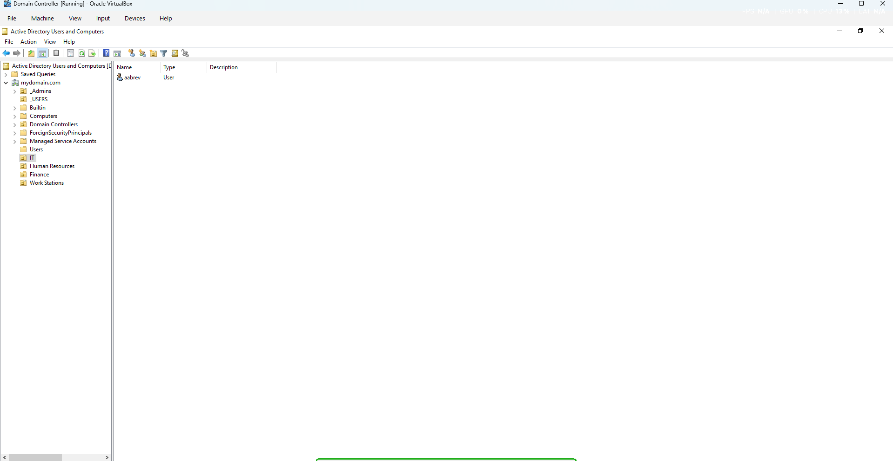
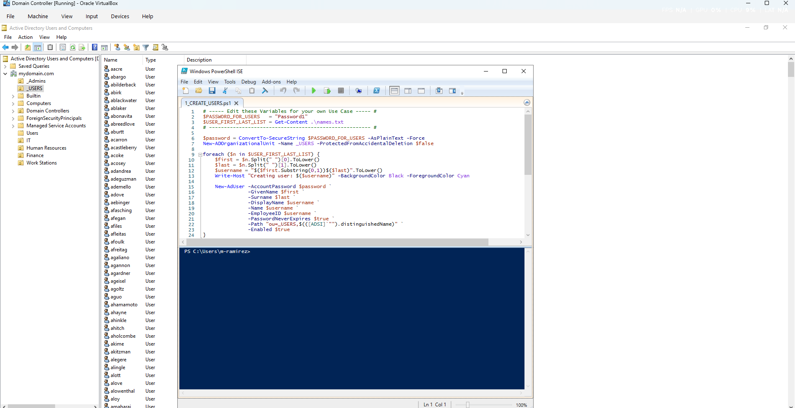
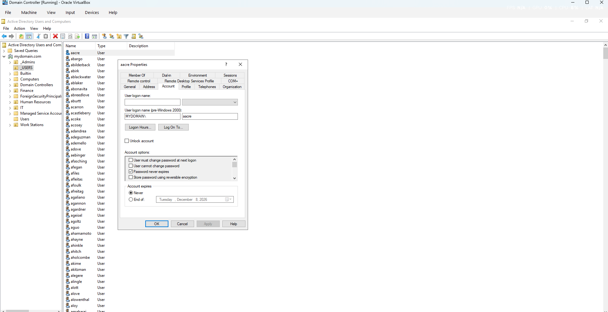
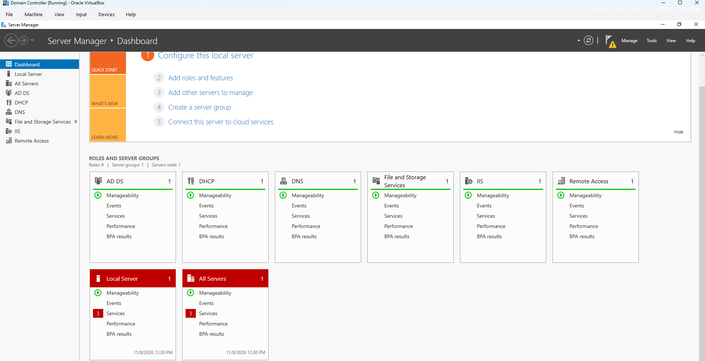
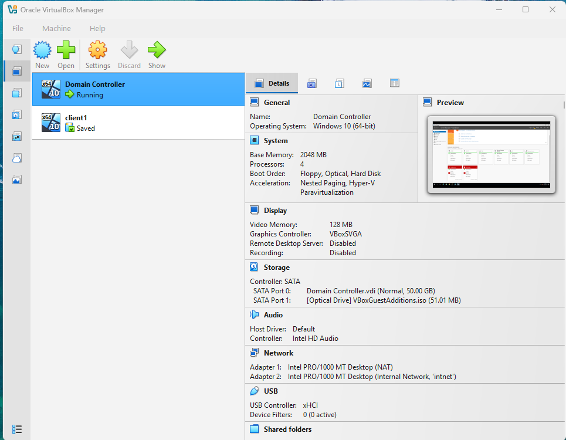

# Active Directory Home Lab

## Project Overview
This project demonstrates hands-on experience with Microsoft Active Directory administration using a virtualized Windows environment.

The lab focuses on user account management, Organizational Units (OUs), PowerShell automation, and security group administration.

## Technologies Used
- Oracle VirtualBox
- Windows 10/11
- Active Directory
- Windows PowerShell

## Skills Demonstrated
- Active Directory user management
- Creating and organizing Organizational Units
- PowerShell user provisioning
- Managing security groups and group memberships
- IT Help Desk troubleshooting fundamentals

## Lab Screenshots

### 1. Organizational Units
Created departmental Organizational Units to organize Active Directory users.

### 2. Active Directory User Management
Created and managed domain user accounts.

### 3. Password Reset
Practiced resetting user passwords through Active Directory.

### 4. Active Directory Server
Configured an Active Directory lab environment.

### 5. VirtualBox Environment
Used Oracle VirtualBox to run the virtual lab.

## Project Purpose
This lab was developed to gain practical experience with Active Directory administration and common IT Help Desk responsibilities.

